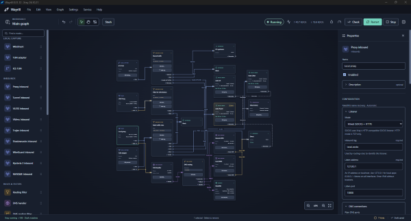

# Wayrill

**Visual traffic and DNS routing for Windows, powered by Xray-core.**
The entire application, apart from Xray-core and third-party dependencies, was
vibe-coded using **OpenAI Codex GPT-6.1 Sol and GPT-6 Astra**.

Wayrill is an open-source application for deciding how traffic leaves your
computer. Keep local destinations on your normal connection, send selected apps
through a proxy, choose different exits for different sites, and give DNS its own
rules. The node editor brings these decisions together in a graph you can inspect
and change.

[**Download the Windows beta**](https://github.com/eliotcougar/Wayrill/releases) ·
[Getting started](docs/guide/getting-started.md) ·
[Documentation](docs/README.md) ·
[Report a problem](https://github.com/eliotcougar/Wayrill/issues)

Windows 10/11 · x64 · First public beta

## Why a graph?

A routing setup becomes harder to reason about as exceptions accumulate. A
per-app rule can depend on a server group; that group's servers need DNS; the DNS
requests need a working route of their own.

The connections between Wayrill nodes express those relationships. A filter
can have named outputs such as **Local**, **Work** and **Everything else**. Each
output leads to a direct connection, a server, a policy group or a proxy chain.
DNS follows a separate, visible path through its own rules and resolvers.
Wayrill generates the Xray configuration from the graph.

For example, one setup can keep LAN traffic direct, route a messaging app and its
child processes through a monitored server group, send selected websites through
another exit, and use a local DNS resolver only for particular domains. A separate
sharing path can route streaming destinations for a connected TV while leaving
other shared traffic direct.

## What you can do

### Build rules, then see why a connection took its route

Traffic filters contain ordered rules: the first match wins, followed by an
explicit **Unmatched traffic** route. Match domains, IP ranges, GeoSite/GeoIP
groups, ports and protocols. Host TUN and WinDivert also support executable names,
paths and folders, child processes, Windows services and packaged apps.
Chain filters when it makes a large ruleset easier to organize.

Each traffic filter has a live log showing the destination, matched rule and
chosen output. Search for a failing site or show only unmatched traffic to find
what your rules missed. DNS filters separately select resolver groups and
fallback behavior; FakeDNS can preserve domain names for routing captured traffic.

### Switch routes without rebuilding the graph

**Stash** keeps large subscriptions and reusable routes off the canvas. A policy
group selects servers from a filtered subscription, manual members, or both,
using strategies such as lowest latency or round-robin. An **Observatory** supplies
availability and delay data. A proxy chain sends traffic through an ordered
sequence of proxies.

Servers, groups and chains can occupy the same outbound position. Star frequently
used entries and mark an outbound as **Main** to switch it from the tray.
**Replace** applies that route immediately, preserving its connections and leaving
unrelated graph edits unapplied.

Subscriptions have individual refresh schedules and can remove unreachable
servers after testing. Locked entries and explicitly used profiles are protected
from deletion during updates.

### Choose how traffic enters

| Entry point | Use it for |
| --- | --- |
| **Proxy inbound** | Apps or clients configured to use SOCKS, HTTP or Mixed mode. |
| **TUN** | Capturing host traffic, including apps that ignore system proxy settings. Wayrill manages its adapter and routes. |
| **ICS TUN** | Routing a Windows Internet Connection Sharing connection separately from host traffic. |
| **WinDivert** | Packet capture on selected network adapters as an alternative to TUN. |

The **System traffic capture** window also manages Windows proxy settings, proxy
environment variables, WinHTTP and AppContainer loopback permissions. The
[protocol reference](docs/reference/protocols.md) covers the other Xray inbound
and outbound editors.

### Maintain and diagnose a working setup

- **Test the actual route.** Check delay, exit IP, optional UDP connectivity and
  download speed for servers, groups and chains. Follow live rates, totals and
  traffic history by source and outbound.
- **Keep rules current without losing local edits.** Import traffic rules from a
  file or URL, add your own entries, and preserve those additions across manual
  refreshes. Browse GeoSite/GeoIP contents and update resource files from the app.
- **Carry your configuration with you.** Back up the full setup, a graph, Stash
  or an individual filter, with optional password encryption. Import and export
  supported Xray JSON configurations and compatible v2rayN traffic rules.

A Windows service owns routing, system changes, scheduled maintenance and
recovery. These continue with the editor closed. Optional startup before sign-in
and automatic recovery after transient failures support unattended use. Closing
the window hides it in the tray; **Stop** explicitly ends routing.

## Get started

1. Install the `.exe` from [Releases](https://github.com/eliotcougar/Wayrill/releases).
   It includes the matching networking service and core components. Setup needs
   administrator approval; the editor runs as your normal account.
2. Start with the default **Local proxy → Direct** graph, or choose a starter
   under **File → Load Example**. **TUN → Direct** is the starting point for host
   capture. Direct uses your existing connection; Wayrill does not supply servers
   or a subscription.
3. Import your profiles or subscription into **Stash**, then right-click an
   outbound and choose **Replace**. Add traffic and DNS rules as needed.
4. Run **Check**, use **Validate** in the results window, then **Start**. For a
   Proxy inbound, point your app at it or select it in **System traffic capture**.
5. Test your outbounds. As you add traffic filters, use their **Traffic log** to
   verify rule matches. Ordinary graph edits take effect when you **Apply**;
   outbound replacement is an explicit immediate switch.

The [examples guide](docs/guide/examples.md) explains each starter, including DNS
routing, FakeDNS, policy groups and chains. Examples with remote servers contain
placeholders that must be replaced with your own working profiles.

## Beta status

Expect rough edges in this beta, particularly around unfamiliar adapter, VPN and
sharing combinations. Back up a working setup before experimenting; keep another
way to reach a PC you manage remotely. The current installer is unsigned.

Sharing uses Windows ICS and supports destination-based rules; selecting individual
shared clients by IP or MAC is not available. Selected-app protection blocks
traffic during routing transitions, rather than providing a permanent kill
switch. See [beta limitations](docs/BETA.md) and the
[sharing guide](docs/guide/sharing.md) before relying on those features.

Wayrill ships custom Xray builds for its Windows integration and shared FakeDNS.
Every modification is documented in the
[core customization inventory](docs/development/xray-customizations.md), with
source and build inputs available for review.

## Development and feedback

The desktop uses React, TypeScript and Tauri; the service and workers use Rust,
with Go integrations for Xray. See the [Windows build guide](docs/development/building.md),
[architecture](docs/development/architecture.md) and [contribution guide](CONTRIBUTING.md).
Editor development starts with Node.js and `npm ci`; an installed service or
test VM is not required. The manual **Windows installer** Actions workflow can
build the complete package in a fork using public inputs.

Bug reports are most useful when they include the intended route, what happened
instead, and steps to reproduce it. See [troubleshooting](docs/guide/troubleshooting.md)
for diagnostics, and remove credentials and subscription tokens before posting.
Report security issues through the [private reporting process](SECURITY.md).

## License and acknowledgements

The application and coordinator are MIT-licensed. The separate capture/attribution
worker is GPL-3.0-only; Xray-derived code is MPL-2.0. See [LICENSE](LICENSE), the
[worker license](service/capture/LICENSE) and [third-party notices](THIRD_PARTY_NOTICES.md)
for the full component breakdown.

Wayrill builds on [Xray-core](https://github.com/XTLS/Xray-core), with inspiration
from [v2rayN](https://github.com/2dust/v2rayN) and
[v2rayNG](https://github.com/2dust/v2rayNG). Its interface uses
[Tauri](https://tauri.app), [React Flow](https://reactflow.dev) and
[libavoid-js](https://github.com/Aksem/libavoid-js). The GeoSite/GeoIP maintainers
provide the resource lists used by its routing presets.
